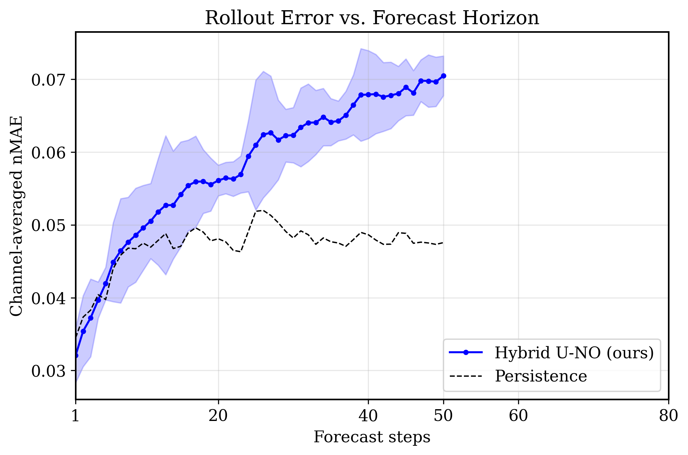

# Neural forecasting of black-hole accretion simulations

Simulations of gas spiralling into a black hole (general-relativistic magnetohydrodynamics, or
GRMHD) are among the most expensive runs in computational astrophysics: one run takes weeks on a
supercomputer. This project builds **learned surrogates**: neural networks that read one snapshot of
a simulation and predict the next one, fast enough to stand in for part of a run. The work is
in-progress research by Kevin Fortune. It covers the whole path from raw simulation output to a
trained, evaluated model on national HPC systems (NCSA Delta and NERSC Perlmutter).

| Model | Status | Where |
|---|---|---|
| **Vision transformer (ViT)** | Current model, under active development | [`3Dtransformer/`](3Dtransformer/) |
| **Spherical Fourier neural operator (SFNO)** | **Retired** in favour of the transformer; kept with its evaluation results | [`SFNO/`](SFNO/), [`eval/`](eval/), [`eval_results/`](eval_results/) |

## The problem

The training data comes from simulations run with **H-AMR**, a GPU-accelerated GRMHD code with
adaptive mesh refinement (Liska et al. 2022; full reference under [Credits](#credits)). Each
snapshot is a 3D grid in spherical coordinates (radius r, polar angle θ, azimuth φ) with 8 physical
variables per cell: gas density, internal energy, three velocity components and three
magnetic-field components. The main dataset (`rc300`) has a 112 × 48 × 96 grid, about 4 million
values per snapshot, and 9,636 consecutive snapshots.

The model is given snapshot *t* and must predict snapshot *t + 1*. That makes it a forecasting
problem on a large, structured, multi-channel field, with constraints a generic model ignores:
mass must be conserved, the magnetic field must stay divergence-free (∇·B = 0), and no gas may
move faster than light. Every model is scored against **persistence** (predicting that nothing
changes), a baseline that is hard to beat when a single step changes little.

## Repository layout

```text
3Dtransformer/          the transformer (current work); 3Dtransformer/README.md has the details
  vit/                  model, experiment registry, distributed training loop
  common/               data loading, normalization, physics-informed loss
  data/                 preprocessing of the raw simulation output, with a cross-check
  eval/                 evaluation on a held-out test period, training-curve plots
  docs/                 data handoff notes, a guide to reading the evaluation report
  scripts/              Slurm job scripts (Delta, Perlmutter)
  smoke_test.py         42 data-free checks of the model and training loop
SFNO/                   the retired SFNO: model and training (train_forecast.py)
eval/                   SFNO evaluation: tables, figures, rollouts
eval_results/           SFNO evaluation output (tables as .txt, figures as .png)
```

## The transformer (current model)

[`3Dtransformer/vit/model.py`](3Dtransformer/vit/model.py) adapts the vision transformer to 3D physical fields.

- **Patch tokens on a spherical grid.** The grid is cut into 4 × 4 × 4 patches, and each patch
  becomes one token holding all 8 variables: 8,064 tokens. Full self-attention then relates every
  region of the flow to every other in each layer. A per-variable mode (one token per variable per
  patch) is also supported; it is 64× more expensive in attention and was used for the first
  baseline.
- **Residual forecasting.** The model predicts the *change* between snapshots. Its output layer is
  zero-initialized, so training starts from persistence and learns corrections to it.
- **Geometry-aware position encoding.** A fixed sinusoidal encoding of each patch's (log r, θ, φ)
  that is exactly periodic in φ, so the model sees the azimuthal wrap-around as continuous.
- **Precision where it matters.** Only the transformer blocks run in bfloat16. The embedding,
  output layer and residual stream stay in float32, so small predicted changes are not rounded
  away.
- **Physics-informed loss with a curriculum.** Training starts on reconstruction error alone. Terms
  for ∇·B and per-shell mass conservation are then ramped in, alongside gradient and spectral terms
  and guards that keep velocities below the speed of light. Several fixes to the inherited loss are
  documented in [`common/physics_loss.py`](3Dtransformer/common/physics_loss.py); for example, the mass term
  originally gave almost all its weight to the outermost shells.
- **~63M parameters**, trained with AdamW, warmup and cosine decay.

The engineering around the model is built for long runs on shared clusters:

- **Reproducible experiments.** Every hyperparameter lives in a named, never-edited entry of an
  experiment registry ([`vit/config.py`](3Dtransformer/vit/config.py)). Each run saves its full
  configuration and refuses to resume if the experiment has changed since.
- **Fault-tolerant distributed training.** Multi-GPU DDP via `torchrun`. Chains of 48-hour Slurm jobs
  resume from checkpoints automatically, and the data loader retries transient file-system errors.
- **Data pipeline.** [`data/preprocess_rc300.py`](3Dtransformer/data/preprocess_rc300.py) turns the raw
  simulation output into training data: 9,636 snapshots, 149 GB, written in under two minutes on
  Perlmutter. It is validated against the simulation code's own reader, and its decisions (cropping,
  resolution, train/validation/test split) are recorded in
  [`docs/rc300_preprocessing.md`](3Dtransformer/docs/rc300_preprocessing.md).
- **Evaluation on unseen data.** The last 10% of the simulation is a blind test period. The suite
  reports per-variable accuracy and skill against persistence, multi-step rollouts and the physics
  diagnostics. [`docs/reading_the_evaluation.md`](3Dtransformer/docs/reading_the_evaluation.md) explains
  how to read each table.

### Active areas of improvement

1. **Better normalization of vector fields.** Velocity and magnetic field are normalized one
   component at a time with arcsinh. In the outer region, where the fields are weak, arcsinh is
   nearly linear, so errors there barely register in the loss. Where a component changes sign,
   arcsinh creates sharp jumps. The first alternative, now being tested, encodes each vector as
   the log of its magnitude plus a unit direction (`vit_rc300_magdir_v1`). Candidates are kept to
   transforms that act on each value alone, so a trained model is not tied to one grid.
2. **A convolutional decoder.** Each token is decoded to its patch by one linear layer,
   independently of its neighbours. That can leave seams at patch edges and limits fine-scale
   detail. A convolutional decoder over the reassembled grid would let neighbouring patches inform
   every output cell.
3. **Predicting fluxes rather than differences.** The model predicts each cell's change directly.
   Predicting the fluxes across cell faces instead mirrors how finite-volume solvers like the one
   that produced the data work: whatever leaves one cell enters its neighbour. Conservation would
   then hold by construction instead of being encouraged by a penalty in the loss.

## The SFNO (retired)

The first model, [`SFNO/train_forecast.py`](SFNO/train_forecast.py), was a hybrid U-Net / neural
operator built on an earlier convolutional baseline by Sachin Venkatesh. Its encoder and decoder
use (2+1)D convolutions with padding that wraps correctly across the poles and in φ. Its bottleneck
is three spherical Fourier neural operator blocks, which mix channels in the joint space of
spherical harmonics (θ, φ) and radial Fourier modes. It was trained on 16 GPUs across 4 Perlmutter
nodes, on an earlier dataset (48 × 96 angular grid, a snapshot every 25 gravitational time units),
so its numbers are not directly comparable with the transformer's.

Results on 1,263 held-out samples, from [`eval_results/`](eval_results/), using normalized mean
absolute error (nMAE; lower is better):

| | SFNO | Persistence |
|---|---|---|
| One-step nMAE, mean of 8 variables | **0.0354** | 0.0380 |
| Variables where the SFNO beats persistence | 4 of 8 | |
| Parameters / inference time | 35.7M / 116 ms per step | |



One step ahead, the SFNO cut persistence's error by about 7%, but it was worse than persistence on
two of the three magnetic-field components. When fed its own predictions, it fell behind
persistence after a handful of steps (above). Its truncated spectral bottleneck also smoothed away
the fine-scale structure the project is ultimately after. The transformer replaced it.
[`eval_results/labels.md`](eval_results/labels.md) discusses the training curves.

## Run it without the data

The simulation data is not distributed, but both models can be checked on a laptop CPU with
synthetic data:

```bash
pip install -r requirements.txt

python 3Dtransformer/smoke_test.py     # transformer: 42 checks of the model, training loop,
                                # checkpoint/resume and both normalizations (about a minute)
python eval/smoke_test.py       # SFNO: physics loss components and loss logging
```

Training and evaluation need the preprocessed data and GPUs. To run the transformer on real data,
set `GRMHD_DATA_ROOT` to the folder holding the preprocessed datasets. The Slurm job scripts in
`3Dtransformer/scripts/`, `SFNO/` and `eval/` are templates: set `--account` to your own allocation, and
replace the `/path/to/...` placeholders.

## Credits

- **Sachin Venkatesh** wrote TRON, the comparison model whose data loading, normalization, physics
  loss and evaluation suite the transformer reuses, and the convolutional baseline the SFNO was
  built on. Every file that contains his code says so in its header.
- **H-AMR.** The simulation data was produced by collaborators with H-AMR and is not included. The
  preprocessing in `3Dtransformer/data/` is checked against H-AMR's own data reader. If you use this work,
  please cite:

  > Liska, M. T. P., Chatterjee, K., Issa, D., et al. 2022, "H-AMR: A New GPU-accelerated GRMHD Code
  > for Exascale Computing with 3D Adaptive Mesh Refinement and Local Adaptive Time Stepping",
  > *The Astrophysical Journal Supplement Series*, 263, 26.
  > [doi:10.3847/1538-4365/ac9966](https://doi.org/10.3847/1538-4365/ac9966),
  > [arXiv:1912.10192](https://arxiv.org/abs/1912.10192)

- Compute: NCSA Delta and NERSC Perlmutter.

## License

Copyright (c) 2026 Kevin Fortune. All rights reserved. The code is shared for review only; see
[LICENSE](LICENSE).
